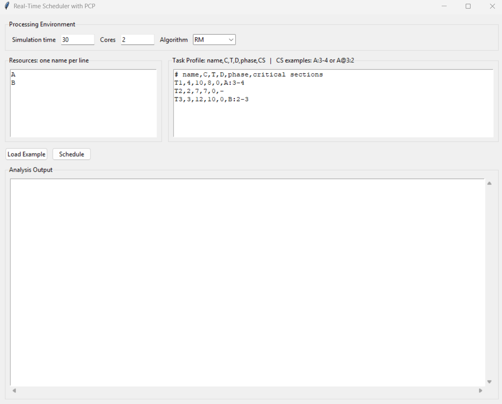
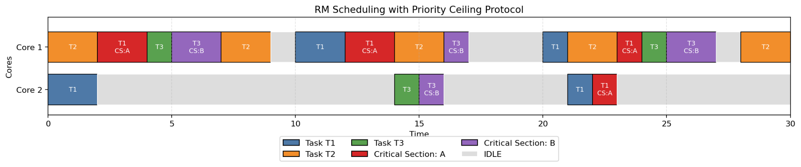

# Real-Time Task Scheduler

A Python scheduler I built for a Real-Time Embedded Systems assignment at Sharif University of Technology. It lets me enter periodic tasks, choose the number of cores, and compare **Rate Monotonic (RM)** and **Earliest Deadline First (EDF)** schedules. The program also models shared resources and critical sections using priority-ceiling rules, then shows the schedule as a Gantt chart.

## What the program does

- Releases jobs according to each task's period and optional starting phase.
- Uses one ready queue for all cores. A job can run on only one core at a time.
- Schedules by task period for RM or by a job's absolute deadline for EDF.
- Tracks named resources, critical sections, priority ceilings, and blocking terms.
- Reports completed jobs, observed response times, deadline misses, utilization, and analytical checks, including the Liu-Layland bound, response-time analysis, and a demand-bound table.
- Draws a color-coded timeline for each core, with critical sections marked separately.

The current interface offers **RM and EDF**. Deadline Monotonic (DM) is not an option in this version.

## Inputs

Set the simulation time, number of cores, and scheduling algorithm at the top of the window. Enter each resource name on its own line, then enter one task per line in this format:

```text
name,C,T,D,phase,critical sections
```

Here, `C` is execution time, `T` is period, `D` is relative deadline, and `phase` is the first release time. Critical-section steps start at 1. For example, `A:3-4` and `A@3:2` both mean that the task uses resource `A` during execution steps 3 and 4. Use `-` if a task has no critical section.

The built-in example uses two cores and these tasks:

```text
Resources: A, B

T1,4,10,8,0,A:3-4
T2,2,7,7,0,-
T3,3,12,10,0,B:2-3
```



## Example output

The report uses **RM**, two cores, and a 30-tick simulation for the example above. In that run, 11 jobs completed and no deadline miss was observed. The schedule used 31 of the 60 available core-time slots.



The analysis output also shows why an observed schedule and a schedulability test are different. Its fixed-priority response-time calculation gives `R = 17` for `T3`, above its deadline of `10`, even though the 30-tick two-core simulation records no miss. This response-time check is not a proof for the global two-core schedule, and a finite simulation cannot prove that all future jobs will meet their deadlines. I use the displayed bounds as analysis aids alongside the simulated timeline.

## Run it

You need Python 3.10 or newer, Tkinter for the desktop interface, and Matplotlib for the Gantt chart. Install Matplotlib with:

```bash
python -m pip install matplotlib
```

Then start the interface:

```bash
python scheduler.py
```

Use **Load Example** to restore the sample inputs, then **Schedule** to see the analysis and chart. The script also has a command-line demo that saves `demo_output.txt` and `demo_gantt.png` in the project folder:

```bash
python scheduler.py --demo --no-gui
```

## Files

| File | Description |
| --- | --- |
| `scheduler.py` | Task parsing, scheduling simulation, analysis output, interface, and Gantt chart |
| `report.pdf` | Course report with the problem, methods, and sample run (in Persian) |
| `images/scheduler-input.png` | Input-window image from the report |
| `images/rm-gantt.png` | RM schedule image from the report |
